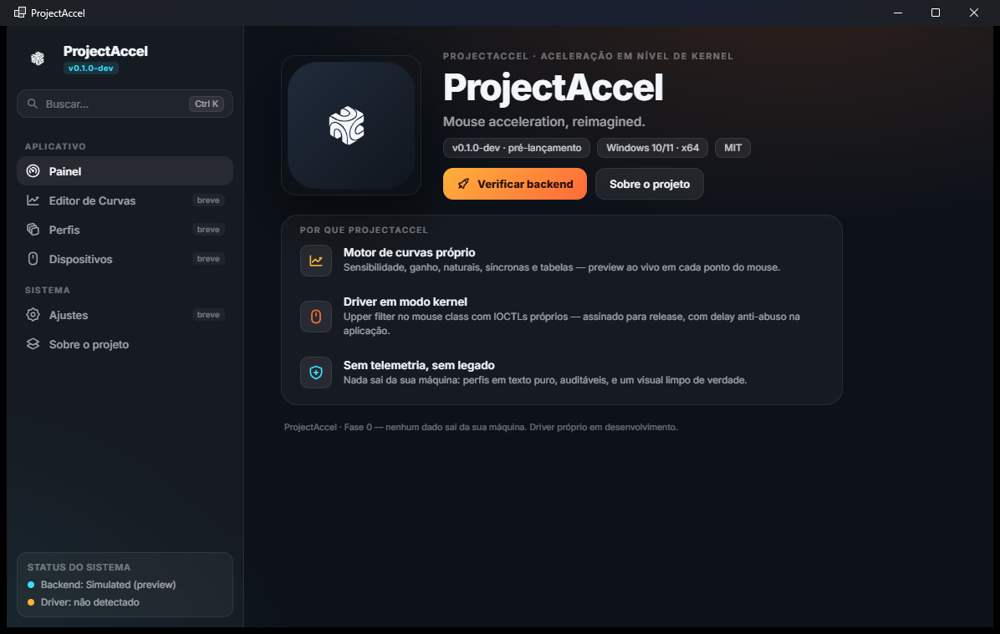

# ProjectAccel

**Mouse acceleration, reimagined.**

App desktop nativo para aceleração de mouse em nível de kernel — visual premium
dark-first, preview de curvas ao vivo e perfis por jogo.




> 🚧 **Status: Fase 0 concluída** (scaffold nativo). Próxima etapa: **Fase 1** —
> editor de curvas + backend simulado. Visão completa em [`docs/PLAN.md`](docs/PLAN.md).

## Visão geral

| | |
|---|---|
| **UI** | React 19 + TypeScript (`web/`), servida num **WebView2** nativo |
| **Host** | WinForms (`net8.0-windows10.0.19041.0`), janela única, dark caption |
| **Driver** | KMDF (upper filter no mouse class), em desenvolvimento — Fase 2 |
| **Backend** | Camada `IAccelBackend`: simulado (preview no app) ↔ driver próprio (`\\.\projectaccel`) |
| **Ícones** | [MingCute](https://www.mingcute.com) |
| **Licença** | MIT |

## Build & run

Pré-requisitos: **.NET SDK 8+** (SDK 10 recomendado), **Node 22+** / npm 10+,
Windows 10/11 com WebView2 Evergreen (já vem com o Edge/VS 2026).

```powershell
cd web
npm ci
npm run build
cd ..
dotnet build
dotnet run --project src/ProjectAccel.App
```

## Estrutura

```
src/ProjectAccel.App/       host nativo (WinForms + WebView2, bridge chrome.webview)
src/ProjectAccel.Core/      domínio: curvas, perfis, dispositivos, KPIs (Fase 1)
src/ProjectAccel.Backend/   IAccelBackend + SimulatedBackend / ProjectAccelBackend
web/                        UI React (Vite) — build vai para wwwroot/ do host
driver/                     driver KMDF (Fase 2, projeto WDK separado)
assets/logo/                marca (o nó isométrico) em todas as variantes
docs/                       plano de produto, screenshot
tests/                      vetores de curva e testes de domínio
```

## Créditos

O ProjectAccel é um projeto independente, sem afiliação com nenhum outro software
de aceleração de mouse. Ícones: MingCute (Apache-2.0/MIT conforme o arquivo de licença do pacote).
